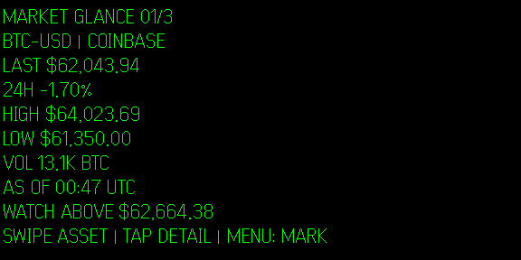

# Market Glance — Even Realities G2

Market Glance is a calm, glanceable Coinbase market brief for Even G2. Swipe between BTC-USD, ETH-USD and SOL-USD; tap for compact detail. A G2 contextual-menu action or a browser control can set a local price marker at +1% or -1% from the current live price. The market feed remains read-only: there are no orders, accounts, API keys, custody or trading recommendations.

**Track:** Exchanges & Stocks (Coinbase is listed in this track).

## Simulator proof

The screenshot below was captured from the production `dist` served at its root URL in the official Even Hub simulator v0.9.5. It shows a live BTC quote and a +1% marker set through the glasses contextual menu; after stopping and restarting the simulator process, the marker and quote were restored. Swipe BTC→ETH, tap for details, **Clear mark**, menu selection events and live quote refresh were also exercised.



`evidence/g2-final-watch.png` is the raw RGBA framebuffer; its preview composites lit-pixel alpha against a dark background. The simulator does not render the system exit-confirmation dialog: the official [Beta Testing guide](https://hub.evenrealities.com/docs/test/beta-testing) says it appears only on a real install. The root-page handler receives double-click event 3 and calls `shutDownPageContainer(1)`, but that dialog still needs validation on a real install. A first BTC request during the simulator run returned 502; a later live refresh recovered. Serving the raw `.ehpk` as a static octet-stream URL did not render in the simulator, so simulator verification used the production build output that was packaged.

## Important timing note

This is a **pre-hackathon prototype** created on 20 November 2026. The official build window begins on 23 November 2026 at 12:00 Dubai time (15:00 WIB). DoraHacks rules say projects must be built during the hackathon. Do not present this pre-event work as a compliant final submission: continue or rebuild during the event and disclose pre-existing code/assets in the final README. The repository and read-only backend are public; the project has not been submitted.

## Run the local demo

Requirements: Node.js 22+ and npm.

```bash
npm install
npm run dev
```

Open the Vite URL shown in the terminal (normally `http://localhost:5173`). The browser preview has asset selection, detail controls, refresh, and local marker buttons. The local Node middleware fetches Coinbase Exchange public statistics through `/api/market/:product`, validates the response, restricts product IDs to the three-item watchlist, caches briefly and serves the last successful response with a visible stale marker during an upstream outage.

### Even Hub simulator

Keep the Vite dev server running, then start the official simulator in a second terminal:

```bash
npx --yes @evenrealities/evenhub-simulator@0.9.5 http://localhost:5173 --automation-port 9898
```

On G2/R1, swipe up/down to move through the watchlist and tap once for details. Open the Even OS contextual menu to choose **Mark +1%**, **Mark -1%** or **Clear mark**. The menu selection is handled by `menuItemClickEvent`; the value is saved via Even Hub local storage. Simulator automation can open that menu with `POST /api/input` and `{"action":"context_menu"}`, then move/select with `up`/`down` and `click`. A double tap calls `shutDownPageContainer(1)` on the root page; verify the system confirmation on a real install because the simulator does not render that dialog. In a regular browser, use the matching buttons; arrow keys and Enter demonstrate navigation without hardware.

Custom contextual menus require Even App 2.2.9 or newer. The project pins Even Hub SDK 0.0.16; the official packer stamps a minimum Even App version of 2.2.10 for that SDK. The simulator version used was 0.9.5.

## Local .ehpk package

The official Even Hub CLI v0.2.0 built `Market-Glance-0.1.0.ehpk` (45,380 bytes) from `app.json` and `dist`; it stamped `min_app_version` 2.2.10 and the artifact checksum was verified. The binary package is kept out of this source repository. It has not been uploaded to Even Hub, installed as a beta/private build, or submitted to DoraHacks. Simulator checks exercised the same production `dist` included in the package; CORS and Even App permission enforcement still need an installed-build check.

## Local marker behavior and safety

A marker is set at exactly 1% above or below the selected product's current `last` price. On G2, its JSON is written to both Even Hub local storage and WebView `localStorage`; preview mode uses browser `localStorage`. At startup the app prefers the Even Hub copy and falls back to the WebView copy. The simulator was restarted after setting a marker, and the marker returned automatically. The value never leaves the device/browser and is not sent to Coinbase or the backend. A fresh quote is required to set one.

The app checks the marker only after fresh market data arrives while the page is visible (normally every 30 seconds). Stale/cached data is never used to report that the marker was reached. There are no background actions, push notifications or trade execution; the state is shown only on the open app display. Coinbase market-data requests are read-only. No user funds are held and displayed values are not financial advice.

## Data and production boundary

- Source: [Coinbase Exchange Get product stats](https://docs.cdp.coinbase.com/exchange/reference/exchangerestapi_getproductstats), public `GET /products/{product_id}/stats`. The app computes 24-hour change as `(last - open) / open × 100`; volume is in the base asset.
- Coinbase is the only external market-data provider, and the app has no Coinbase credentials. The local Node middleware or the deployed Worker—not the Even Hub web app—calls Coinbase.
- The read-only Cloudflare Worker is available at `https://market-glance-api.pikrimahardhika.workers.dev`; its health endpoint is `/api/health`. `app.json` whitelists this origin, and `.env.production` supplies it to production builds. Local Vite development continues to use the same-origin middleware unless explicitly overridden. The Worker allows only BTC-USD, ETH-USD and SOL-USD; it has a brief per-isolate cache and supports stale fallback when available. Cloudflare Workers Free limits apply. The local middleware is not bundled into an installed app. The packaged build's CORS and Even App whitelist enforcement still require an installed-build check.
- `.env*` files are ignored except `.env.example` and the public `.env.production`; commit no secrets or production credentials. Vite embeds `VITE_` variables in the client bundle.

## Test and build

```bash
npm test
npm run typecheck
npm run build
npm audit --omit=dev --audit-level=moderate
```

Tests cover market parsing/change calculation, display formatting/range behavior, watch creation from live snapshots, corrupted local storage, threshold evaluation and compact G2 rendering, plus endpoint validation, product allow-listing, CORS, cache behavior, stale fallback and malformed upstream data. Tests use deterministic fixtures and do not place orders or call a live market endpoint.

## Before any hackathon submission

After the build window opens, continue/rebuild during the event and accurately disclose pre-existing work. Install and test this exact package as a beta/private build, including live API/CORS and permission behavior, a five-minute locked-phone run, and the root-page exit dialog on real G2 hardware if available. Prepare setup notes, a demo video up to 3 minutes, the short problem/user/how-it-works/track description, and up to five API feature requests if any are discovered. Submit through DoraHacks only after the event-compliant result has been reviewed and the user explicitly approves; no submission has been made.

## Official references

- [Heads Up: Even Realities Hackathon — rules, tracks, schedule and judging](https://dorahacks.io/hackathon/even-realities)
- [Even Hub — Your First App](https://hub.evenrealities.com/docs/get-started/quickstart/first-app)
- [Even Hub — Device APIs](https://hub.evenrealities.com/docs/build/device-apis)
- [Even Hub — Contextual Menu](https://hub.evenrealities.com/docs/build/contextual-menu)
- [Even Hub — Networking and CORS](https://hub.evenrealities.com/docs/build/networking)
- [Even Hub — simulator workflow](https://hub.evenrealities.com/docs/test/simulator)
